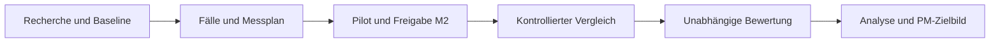

# KI-gestütztes Projektmanagement

**IPM · Projektteam 4 · Wintersemester 2026/27**

Wir untersuchen, wie generative KI ausgewählte Aufgaben des Projektmanagements verändert: Bearbeitungszeit, Ergebnisqualität sowie Zusammenarbeit und Verantwortung zwischen Mensch und KI.

> **Forschungsfrage:** Bei welchen Projektmanagement-Aufgaben verbessert KI die Effizienz und Ergebnisqualität, und wie verändern sich dabei menschliche Aufgaben und Verantwortlichkeiten?

**Aktueller Stand:** Forschungs- und Versuchsplan, erste Quellen und lokaler Demonstrator vorhanden. Fallstudie, Aufgabenverteilung und Termine sind Arbeitsvorschläge. Es gibt noch keine formale Datenerhebung, validierte Fallgleichheit oder empirischen Ergebnisse. Die reale KI-Anbindung benötigt einen API-Key und einen Live-Pilot.

## Hier anfangen

| Bereich | Was gehört hierhin? | Einstieg |
|---|---|---|
| **01 · Projektsteuerung** | Ziel, Team, Aufgaben, Roadmap, Meilensteine und Freitagstermin | [Projektübersicht](docs/01-project/README.md) |
| **02 · Recherche** | PM-Baseline, KI-Lösungen, Chancen/Risiken, Suchprotokoll und Quellenbewertung | [Recherche starten](docs/02-research/README.md) |
| **03 · Experiment** | Bedingungen, Zuteilung, Fälle, Messgrößen, Rubrik und Pilot | [Versuch aufbauen](docs/03-experiment/README.md) |
| **04 · Demonstrator** | Lokaler Start, KI-Konfiguration, Datenexport und technische Prüfung | [Prototyp starten](docs/04-prototype/README.md) |
| **05 · Ergebnisse** | Analyseplan, Bericht und zukünftige PM-Organisation | [Auswertung vorbereiten](docs/05-results/README.md) |

中文说明：[项目与原型快速使用](docs/START-ZH.md)。原始课程材料保留在仓库根目录的 `Projekte Aufgaben` 文件中；本项目的具体研究设计是团队工作方案。

## Vom Thema zum Ergebnis



**Nicht mit „zwei verschiedenen Teams“ verwechseln:** Unsere vorgeschlagene Studie nutzt zwei Bedingungen innerhalb derselben Person. Jede Person arbeitet einmal manuell und einmal mit KI an verschiedenen Fällen. Vier Sequenzen gleichen Fall und Reihenfolge aus. Details und Alternativen stehen im [Leitfaden zum kontrollierten Vergleich](docs/03-experiment/controlled-comparison.md).

## So arbeiten wir auf GitHub

1. **Arbeit auswählen:** [Issues](https://github.com/Sam18069272581/KI-gest-tztes-Projektmanagement/issues) nach Bereich und Meilenstein filtern. Eine Person übernimmt den Lead; reale GitHub-Zuordnung erst nach Bestätigung des Accounts.
2. **Quellen bearbeiten:** Für jede relevante Quelle einen Eintrag im [Literaturregister](docs/02-research/literature-register.md) und bei zentralen Befunden eine Evidenzkarte anlegen. Ergebnisse mit Quelle und Grenzen dokumentieren.
3. **Änderung vorschlagen:** Kurzen Arbeitsbranch erstellen, Ergebnisse per Pull Request einreichen. Eine andere Person prüft fachlich; keine unmarkierten KI-Texte als Literaturbeleg behandeln.
4. **Entscheidung festhalten:** Beschlüsse in [Decision Log](docs/01-project/decisions.md) übernehmen. Erst nach erfüllten Abnahmekriterien ein Issue schließen.

Aktive Aufgaben und M1–M4: [Arbeitsübersicht](docs/01-project/workboard.md). Regeln und Vorlagen: [CONTRIBUTING](CONTRIBUTING.md).

## Freitag, 30.10.2026

[60-Minuten-Agenda, Teamvorschlag und Roadmap](docs/01-project/team-roadmap-agenda.md). Ziel: Forschungsfrage, Fallauswahl, zwei Aufgaben, Leads und die nächsten Abgabetermine verbindlich klären. Uhrzeit und endgültiger Seminarabgabetermin sind offen.

## Demonstrator und Prüfungen

```powershell
python server.py
```

Browser: **http://127.0.0.1:8874**. Python 3.11+; keine pip-Pakete nötig. [Installation und echte KI-Konfiguration](docs/04-prototype/quickstart.md).

```powershell
python -m unittest discover -s tests -v
python scripts/check_docs.py
node --check web/app.js
```

Status und Prüfgrenzen: [Verifikationsstand](docs/04-prototype/verification.md). CI prüft Logik, Dokumentlinks und JS-Syntax; sie führt keine kostenpflichtigen Live-KI-Aufrufe aus.

## Was bleibt privat?

Dieses Repository ist öffentlich. Keine Telefon-/E-Mail-Listen, Einladungslinks, Schlüssel, Teilnehmerdaten oder Rohlogs hochladen. Die mitgelieferten A/B-Fälle sind **öffentliche Pilotfälle**. Für eine formale Studie frische, nicht vorab veröffentlichte Fallvarianten und Referenzantworten in einem geschützten Arbeitsbereich vorbereiten. Ein Unterordner im öffentlichen Repository ist kein Zugriffsschutz. Siehe [Daten- und Materialregeln](docs/03-experiment/data-and-materials.md).

## Technischer Aufbau

| Pfad | Zweck |
|---|---|
| `lab.py`, `server.py` | Studienzustand, Bedingungen, Zeitlimit und lokale API |
| `web/` | Deutsche Teilnehmeroberfläche |
| `cases.json`, `prompt.txt` | Öffentliche Pilotmaterialien und Prompt |
| `manage.py`, `analysis.py` | Lokale Studienleitung, Bewertungspakete und deskriptive Analyse |
| `tests/` | Isolierte Tests mit temporären Datenbanken |
| `docs/`, `.github/` | Wissensbasis, Zusammenarbeit und Automatisierung |
| `data/` | Lokale Daten; von Git ausgeschlossen |
